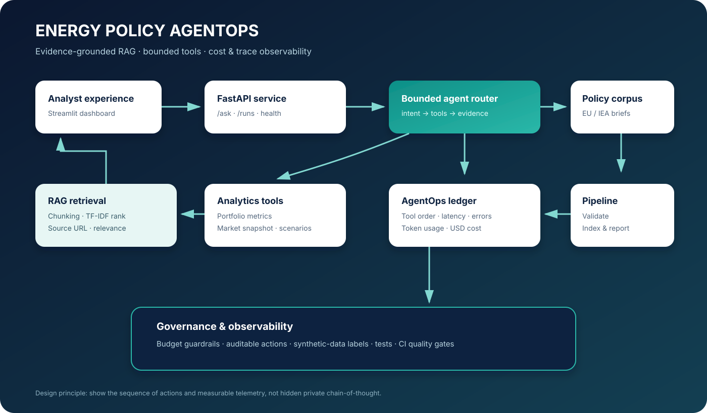
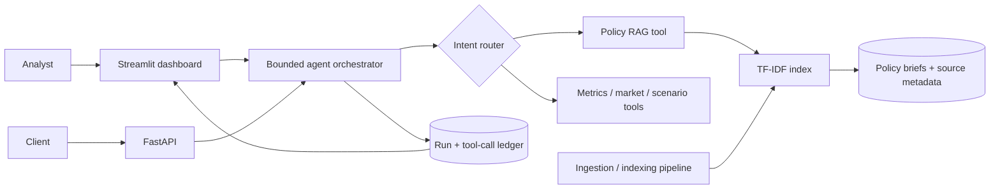

# Energy Policy AgentOps Platform

> **Evidence-grounded energy-policy intelligence with tool orchestration, RAG, auditable execution traces, cost governance, and an executive dashboard.**



## Executive overview

Energy Policy AgentOps is a service-oriented AI platform for energy-policy analysis. It combines a retrieval-augmented generation (RAG) layer over source-linked EU/IEA policy briefs, typed analytics tools, a bounded orchestrator, an HTTP API, an interactive dashboard, a durable tool-call ledger, and a repeatable ingestion/indexing pipeline.

The implementation is designed around operational controls: bounded tool count, per-request spend ceiling, explicit tool order, latency and error recording, source-linked evidence, synthetic-data labelling, and deterministic fallback when no LLM credential is configured.

## Capabilities

- **RAG:** paragraph-aware chunking, TF-IDF retrieval, relevance scores, source URLs, corpus checksums, and index rebuild pipeline.
- **Tool orchestration:** policy retrieval, portfolio metrics, synthetic market snapshot, and transparent scenario calculation.
- **AgentOps:** per-run ledger; ordered tool events; input/output summaries; success/failure status; latency; estimated tool cost; optional LLM token and cost accounting.
- **Cost controls:** configurable per-tool estimates, LLM token rates, maximum tool calls, and a request budget guard.
- **API:** `POST /ask`, `GET /runs`, `GET /runs/{run_id}/trace`, `/health`, and `/ready`.
- **Dashboard:** spend trend, average latency, tool reliability, run ledger, tool telemetry, policy corpus inventory, and interactive agent query.
- **Pipeline:** validate source metadata and document size, calculate SHA-256 checksums, build the retrieval index, and emit a pipeline report. Prefect flow support is optional.
- **Engineering hygiene:** typed request models, tests, Ruff, Docker, Compose, CI workflow, and configuration through environment variables.

## Architecture



## Repository layout

```text
app/
  agent/runner.py       # Routing, tool order, budget guard, optional LLM synthesis
  agent/tools.py        # Typed tools and explicit tool cost schedule
  api/main.py           # FastAPI service and run/trace endpoints
  core/config.py        # Environment-based settings
  core/db.py            # Audit-ledger schema and SQLAlchemy engine
  core/telemetry.py     # Run and tool event persistence
  rag/index.py          # Policy chunking and retrieval index
  pipeline/flow.py      # Validation/index pipeline; optional Prefect flow
data/
  policy_docs/          # Source-linked analytical briefs about energy policy
  sample_data/          # Synthetic asset and wholesale-market tables
dashboard.py             # Streamlit AgentOps dashboard
scripts/                 # Indexing and data-quality entry points
tests/                   # Unit tests
assets/architecture.svg  # Architecture illustration embedded above
```

## Quick start

### 1. Create an environment

```bash
python -m venv .venv
source .venv/bin/activate       # Windows: .venv\Scripts\activate
pip install -e .
cp .env.example .env
```

### 2. Build the policy index and run data validation

```bash
python scripts/build_index.py
```

This validates the corpus, computes content checksums, builds the local retrieval index, persists chunk metadata, and writes `artifacts/pipeline_report.json`.

To enable Prefect orchestration:

```bash
pip install -e '.[pipeline]'
python -m app.pipeline.flow
```

### 3. Launch the dashboard

```bash
streamlit run dashboard.py
```

Open the local URL printed by Streamlit (usually `http://localhost:8501`). Submit a question and inspect the answer, ordered tool trace, cost estimate, and latency.

### 4. Launch the API

In a second terminal:

```bash
uvicorn app.api.main:app --reload --port 8000
```

API docs are available at `http://localhost:8000/docs`.

Example request:

```bash
curl -X POST http://localhost:8000/ask \
  -H 'Content-Type: application/json' \
  -d '{"question":"Summarise EU renewable energy policy and what an analyst must verify before making a compliance claim."}'
```

Example endpoints:

```text
GET  /health
GET  /ready
POST /ask
GET  /runs?limit=50
GET  /runs/{run_id}/trace
```

### 5. Optional LLM synthesis

Set `OPENAI_API_KEY` in `.env`. The agent first retrieves evidence and executes the chosen tools, then sends the bounded evidence bundle to the configured model for synthesis. Usage tokens are read from the provider response and cost is calculated using configurable per-million-token rates. Without a key, the service still returns a deterministic evidence report.

> **Cost note:** token prices vary by model/provider and can change. Update `.env` with the actual rates for the model and account you use. Tool costs in this repository are explicit internal estimates, not cloud-provider invoices. For production billing, reconcile against provider billing exports.

### 6. Docker Compose

```bash
cp .env.example .env
docker compose up --build
```

Dashboard: `http://localhost:8501` · API docs: `http://localhost:8000/docs`.

## Agent execution and observability

The service records the following observable sequence for every request:

1. Create run record and assign a run ID.
2. Classify intent using explicit routing rules.
3. Check per-request budget before each tool call.
4. Execute the selected tool and record start time, sequence number, status, latency, input/output summaries, and estimated cost.
5. Optionally synthesize a final response from retrieved evidence with an LLM.
6. Record token usage, calculated LLM cost, total cost, total duration, and final status.
7. Return answer, run ID, tool trace, and cost breakdown to the caller.

The platform intentionally exposes **tool/action traces and short execution summaries**, not hidden private chain-of-thought. The trace is the operationally useful record: what tool ran, in what order, with what bounded input, what result/status, how long it took, and what it cost.

## Tool contracts

| Tool | Input | Output | Estimated tool cost |
|---|---|---|---:|
| `search_policy_docs` | query, top_k | ranked excerpts, topics, source URLs, scores | $0.0002 |
| `calculate_energy_metrics` | optional country | synthetic capacity, generation, weighted intensity, asset mix | $0.0001 |
| `get_market_snapshot` | country | latest synthetic market observation | $0.0002 |
| `run_policy_scenario` | renewable share, demand, carbon price | transparent price scenario and assumptions | $0.0005 |

These are deliberately typed tools rather than arbitrary code execution. Tool arguments are bounded and validated, and the scenario tool explicitly labels its output as illustrative rather than a forecast.

## Dashboard panels

- **Executive KPIs:** total runs, tracked spend, average latency, tool-call volume.
- **Spend trend:** daily sum of total estimated run costs.
- **Tool reliability:** calls by tool and status.
- **Run ledger:** run ID, model, status, tool count, latency, cost, question.
- **Tool telemetry:** ordered tool event data and estimated cost per call.
- **Policy corpus:** document inventory and rebuild control.

## Energy-policy corpus

The included documents are **original analytical summaries**, not copies of the underlying laws or reports. Each links to its official publisher page. The corpus covers renewable energy, energy efficiency, EU ETS, electricity market design, batteries, EU Taxonomy, IEA scenarios, CBAM, grids, and just transition.

Official source links are included in each Markdown file. Policy rules change: verify the latest official text, jurisdiction, effective date, and implementation details before using any answer for compliance or investment decisions. This platform does not provide legal advice.

## Synthetic datasets

- `energy_assets.csv`: illustrative asset portfolio across EU countries and technology types.
- `market_prices.csv`: illustrative hourly-independent daily observations for a calendar year, with wholesale price, demand, renewable share, and carbon-price variables.
- `policy_questions.jsonl`: example evaluation prompts and expected topics.

The numerical values are synthetic and must not be represented as real market or official energy statistics.

## Quality gates

```bash
ruff check app tests
pytest -q
```

## Production hardening checklist

Before external or regulated deployment, add or validate:

- Managed Postgres, secrets manager, encryption at rest/in transit, backups, and retention policy.
- OIDC/SSO, role-based authorization, tenant isolation, rate limiting, request authentication, and audit access controls.
- Provider billing reconciliation, model-specific pricing configuration, budget alerts, and per-user cost attribution.
- Hybrid retrieval (BM25 + embeddings), reranking, evaluation set, recall@k / MRR, citation correctness, and prompt-injection tests.
- Versioned policy corpus, legal review, source freshness checks, and document-level access control.
- Durable queue/orchestration, retries with idempotency, dead-letter handling, and service-level objectives.
- Distributed tracing, OpenTelemetry, Prometheus metrics, structured logs, dashboards, alerting, and incident runbooks.
- PII classification/redaction, data minimisation, threat modelling, dependency scanning, SBOM, and container image scanning.
- Deployment environments, canary release, rollback, load tests, disaster recovery, and security review.

## Design boundaries

This repository provides a runnable reference implementation with working API/dashboard, local RAG, tool traces, and cost accounting. Production readiness still depends on the deployment environment, identity/security integrations, managed persistence, retrieval evaluation, operational SLOs, and a validated model/provider cost feed.
